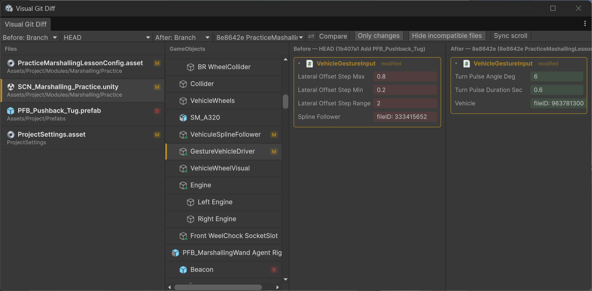

# Unity Git Tool

A Unity Editor window for working with git on scenes and prefabs. Changes show up the way the
Inspector shows a GameObject, so you don't have to read raw YAML in a text diff tool. Pick two
revisions to see which files changed, then select a GameObject or component to compare its fields
side by side. You can roll a change back or resolve a merge conflict field by field.



## Features

One window, **Unity Git Tool**, with three tabs:

### Diff / Merge

- Compare any two revisions: a branch, a commit, or the working tree.
- The file tree lists the changed `.unity` and `.prefab` files. Under each file come its
  GameObjects, prefab instances (with the overridden objects of their source prefab), and
  standalone documents such as an embedded mesh or material.
- The table shows each object's fields, with the A and B values side by side.
- **Rollback**: when B is the working tree, you can mark a field, a component or a whole GameObject.
  The marked changes are written back to A's value in one pass, with one import per file.
- **Merge**: when a merge, rebase, cherry-pick or revert stops on conflicts, the window switches to
  a three-way view. Take A or B per field, delete or restore objects, and preview the resolved
  hierarchy in a second tree. Then apply the result to the working tree.

### Scene Objects

- Shows every open scene as it is saved on disk, with its GameObjects, prefab instances and their
  overrides.
- Selection stays in sync with the Hierarchy.

### Dead Entries

- Scans the project's prefabs and scenes for prefab-instance entries whose target no longer exists
  in the source asset. This happens when a model is re-exported with new ids, or an object is
  deleted from the source prefab.
- Covers overrides, added components and GameObjects, and removed components and GameObjects.
- Unity ignores these entries when it loads the file. Its own save keeps dead overrides and dead
  removed entries until "Remove Unused Overrides" is run.
- Clean them per instance, per file, or all at once.
- `Assets/Samples/` and `Assets/_Recovery/` are skipped.

### Select in Unity

- Selecting a file, GameObject or prefab instance in any tab also selects it in the Project or
  Hierarchy.
- If the object can't be found, the file itself is selected instead. That happens when the scene
  isn't loaded, or when the object only exists in the other revision.
- A toggle in the tab bar turns this off.

## Requirements

- Unity 6000.0 or later.
- `git` on the `PATH`, and the Unity project inside a git repository.

## Installation

In **Package Manager**, choose **+ → Add package from git URL…** and paste:

```
https://github.com/lxtzfr/unity-git-tool.git?path=/Package
```

## Usage

Open one of the three menu items under **Unity Git Tool**:

- **Diff - Merge**
- **Scene Objects**
- **Dead Prefab Entries**

Each one opens the same window on that tab.

## How it works

Unity scenes and prefabs are plain-text YAML. The tool works in four steps:

1. It reads each revision straight from git (`GitFileReader`).
2. It parses the files with its own YAML reader (`UnityYamlParser`), which keeps each value's exact
   position in the text.
3. It builds the GameObject / component tree (`UnityYamlDiffBuilder`, `YamlHierarchy`). Prefab
   instances are resolved against their source assets.
4. Edits are written back as line edits on the original text (`UnityYamlWriter`). Everything the
   tool doesn't touch stays byte for byte as it was.

## License

[GNU General Public License v3.0](LICENSE.md)
